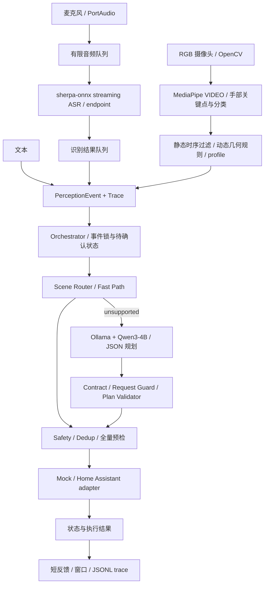

# 项目功能、技术路线与开源方案对标

调研日期：2026-09-09。范围：本地代码审计、官方文档、官方仓库与作者项目页。没有下载或运行候选模型；下文“建议”是基于架构、约束与已有故障的工程判断，不是候选在本机的性能结论。开源项目与模型权重的许可证、运行依赖、支持语言须分别核对，框架开源不自动代表所有权重可任意使用。

## 1. 本项目现在实现了什么

项目是一个开发机上可运行的家庭控制 PoC：把文本、中文语音和摄像头手势转成统一事件，经过确定性路由或本地模型规划，再由应用校验和执行，最终反馈设备状态。主要工程价值在多模态闭环、简单命令的确定性、安全执行和可复现评测。

| 功能 | 当前实现 | 实现边界 |
|---|---|---|
| 文本控制 | 设备查询、开关、参数控制、场景别名 | 确定性词汇与匹配，不是任意自然语言保证 |
| 家庭目录 | 25 个逻辑设备、9 个场景 | 主要为 Mock，不等于真实设备接入数量 |
| 中文语音 | sounddevice/PortAudio → sherpa-onnx streaming transducer → endpoint final | 已有真实会话，但仍有 overflow；无可靠远场质量结论 |
| 语音反馈 | 本地 VITS TTS、短动作摘要、异步播放与回声保护 | 播放时屏蔽输入，不是完整 AEC 或可打断全双工 |
| 静态手势 | MediaPipe VIDEO、21 个关键点、六类静态标签、temporal/latch/release/cooldown | 单帧分数不等于用户意图概率 |
| 动态规则 | swipe_left/right、pinch_up/down | 位移/时长/捏合距离规则，不是学习型动态模型 |
| 交互模式 | media/home profile、可选激活、语音切模式 | 模式不同同一手势语义不同，需在 UI 明示 |
| Agent | Ollama + Qwen3-4B、本地 HTTP、固定 JSON Schema、设备上下文、请求 guard | 单次受约束规划；不是自主反复试错的通用 Agent |
| 简单对话 | 本地固定回答 + 模型 response/clarification/rejected/unavailable | 无长期记忆、RAG、开放域问答保证 |
| 安全执行 | 设备/动作 allowlist、参数验证、计划预检、高风险确认、语音去重 | 不代表跨模态幂等、持久化计划或完整事务 |
| 设备适配 | Mock 与 HA REST adapter | HA 只有一次 read-after-write，尚无真实联调证据 |
| 展示与评测 | 双窗口、关键点、ASR/Gesture/Agent 测试与诊断 | 历史数字按版本、来源、条件分别报告 |
| 本轮观测 | 内容哈希、统一 trace、队列/锁/模型/设备/反馈阶段耗时 | 不会凭新增代码产生真实准确率或目标硬件指标 |

设备功能包括灯亮度、窗帘位置、风速、空调温度/模式、电视和机顶盒播放/频道/音量、音箱、摄像头、门锁、环境与安全传感器。九个场景为回家、离家、观影、睡眠、起床、用餐、夜灯、节能、安防。

本地证据入口：`configs/devices.json`、`configs/scenes.json`、`configs/gestures.json`、`audio/sherpa_onnx_adapters.py`、`vision/dynamic.py`、`agent/local_llm.py`、`app/orchestrator.py`。完整差异校准见 [基线与观测文档](baseline_observability.md)。

## 2. 当前技术路线

这是“感知模型 + 确定性控制 + 受约束语言规划”的组合。各模型解决不同问题：ASR 转录、MediaPipe 识别手形与关键点、LLM 解释部分复杂表达。最终设备权限与副作用由应用掌握。

当前模型不是直接处理原始语音和视频的统一多模态大模型；语音与手势先变成符号事件，再汇入同一控制链。当前也没有“所有 Ollama 错误自动由 rule-based 重跑”的实现：rule-based 是独立可选 provider，模型故障可返回 unavailable。

主要已知问题是实时采集可靠性、慢规划造成其他事件等待的风险、独立目标域评测不足，以及 HA 执行结果缺少目标状态确认。换模型不能自动解决这些问题。

## 3. 语音：成熟方案通常如何组织

### 3.1 完整语音产品链与 ASR 模型分开考虑

典型模块化路线是：音频前端 → 唤醒或按键门控 → VAD/endpoint → ASR → 意图/规划 → 执行 → TTS。AEC、降噪、唤醒、VAD 和 ASR 各自解决不同问题，不能将它们统一称作“提高识别率”。

Home Assistant 的本地语音方案把 STT、理解/控制和 TTS 解耦，可选受限指令转录 Speech-to-Phrase 或开放式 Whisper，再搭配本地 Piper。这说明家庭控制可以同时存在小范围高确定性的指令路线与更灵活的语言路线。[HA 本地语音指南](https://www.home-assistant.io/voice_control/voice_remote_local_assistant/)

Wyoming 以事件和音频流连接语音组件，支持把麦克风端与家庭服务端拆开。值得学习的是协议边界、音频起止事件和组件可替换性；当前单机 PoC 暂无必要为采用协议而拆成多个服务。[Wyoming 官方仓库](https://github.com/OHF-Voice/wyoming)

### 3.2 四类适合比较的识别路线

| 路线 | 开源参考与机制 | 优势 | 成本与适用判断 |
|---|---|---|---|
| 真流式 transducer | sherpa-onnx，当前项目采用的 encoder/decoder/joiner 路线 | 持续消费音频、有 endpoint、适合本地短指令 | 先修采集并调解码/热词，最容易复用现有接口 |
| 中文流式与组合语音流水线 | FunASR 的 Paraformer-zh-streaming 与 VAD/其他模块 | 中文领域候选、逐会话 cache 和流式服务参考 | 必须选 streaming checkpoint；不能把离线吞吐当作实时延迟 |
| 开放词汇分段转录 | whisper.cpp、faster-whisper | 跨语言生态、离线复核和更开放表达候选 | 运行后端、量化与设备差异大；分块转录不等于原生因果流式 |
| 受限指令识别 | HA Speech-to-Phrase | 适合受控命令集合、资源预算明确的控制 | 命令/语言覆盖受限，先核对中文和本项目槽位，不能直接替换开放语言入口 |

资料：[sherpa-onnx 麦克风 endpoint 示例](https://k2-fsa.github.io/sherpa/onnx/python/real-time-speech-recongition-from-a-microphone.html)、[FunASR 官方仓库](https://github.com/modelscope/FunASR)、[whisper.cpp](https://github.com/ggml-org/whisper.cpp)、[faster-whisper](https://github.com/SYSTRAN/faster-whisper)。faster-whisper 使用 CTranslate2，whisper.cpp 提供 C/C++ 推理与量化；两者是 Whisper 的不同部署实现，不是两种新语音建模架构。

SenseVoice 可以作为中文/多语言识别研究候选，但必须按具体版本区分原始离线模型、分段包装与后续流式实现；不能依据“低延迟”或仓库名称推断持续音频的缓存与 endpoint 行为。[SenseVoice 官方 README](https://github.com/QwenAudio/SenseVoice/blob/main/README.md)

### 3.3 前端与交互值得学习什么

- **VAD**：Silero VAD 提供神经网络语音活动检测；WebRTC VAD 是另一种轻量组件。WebRTC VAD 的输入帧长度/采样格式有约束，不能把当前 100 ms float32 块直接当作其输入。VAD 只回答是否有语音，不负责判断用户是否对设备说话。[Silero VAD](https://github.com/snakers4/silero-vad)、[WebRTC VAD Python 接口](https://github.com/wiseman/py-webrtcvad)
- **唤醒**：sherpa-onnx 有关键词检测路线，便于复用部署生态；openWakeWord 值得参考共享音频特征与阈值/误唤醒评测。其现成模型文档以英语为主，不能承诺中文“小兴”开箱即用。[sherpa 文档入口](https://k2-fsa.github.io/sherpa/)、[openWakeWord](https://github.com/dscripka/openWakeWord)
- **回声处理**：WebRTC APM 分别提供 AEC、NS、AGC 等能力。AEC 需要正确处理播放参考与采集链，部署和延迟对齐本身是工程问题；当前屏蔽麦克风输入只是半双工保护。[WebRTC APM 官方说明](https://chromium.googlesource.com/external/webrtc/+/master/modules/audio_processing/g3doc/audio_processing_module.md)
- **反馈**：当前短动作摘要非常适合控制任务。后续应测量“执行结果产生→开始反馈”和“播报完成→重新监听”，而不是优先追求更大 TTS 模型。

### 3.4 对本项目的建议

第一优先仍是已有 sherpa 路线：使用本轮 trace 区分 callback、音频队列、ASR、识别结果队列和执行等待。随后构建近场/远场/噪声与保留说话人数据，分析错误设备、相反动作和参数错误。

建议候选实验为：当前模型基线、一次 endpoint 参数改动、一次热词改动。只有真实音频表明存在模型瓶颈，再追加一个 FunASR 流式或 Whisper 部署候选，共用相同录音、语义判定和资源测量。候选不改变 Fast Path、安全及设备后端。

后续扩展顺序建议：明确监听状态/按键门控 → 中文唤醒验证 → 必要时 VAD/AEC → 独立 ASR 候选。引入唤醒时同时评测漏唤醒和背景内容误唤醒；加入降噪时防止损伤动作词与数字。

## 4. 手势：从帧分类到用户意图

### 4.1 当前路线已经接近轻量产品常用结构

MediaPipe 将手掌检测、手部关键点与手势分类组合起来。VIDEO/LIVE_STREAM 利用跟踪避免每帧都运行手掌检测；LIVE_STREAM 异步返回，在处理繁忙时会忽略新输入帧。换成该模式后必须记录提交帧与回调帧，不能只根据 UI FPS 推断识别吞吐。[MediaPipe Python 指南](https://developers.google.com/edge/mediapipe/solutions/vision/gesture_recognizer/python)

本项目在这之上增加 temporal decoder，解决“保持动作只执行一次、释放才能再触发”。动态部分从腕部轨迹、捏合距离和时间窗口生成符号事件，复用同一控制链。这种分类与事件解码分离的结构值得保持。

### 4.2 三类技术路线与一个评测基础

| 路线 | 做法 | 何时值得采用 | 本项目的代价 |
|---|---|---|---|
| 关键点 + 规则/现成分类器 | MediaPipe + 时序状态机 + 几何轨迹 | 少量明确静态和方向动作，要求可解释 | 已有，继续补独立验证收益最高 |
| 关键点/嵌入 + 自定义轻量分类 | MediaPipe Model Maker，或归一化 landmarks + MLP | 同一手形在目标环境持续混淆 | 需多人数据、none/other、导出一致性与相同 decoder 对比 |
| 视频/骨架时序模型 | TCN/GRU/图卷积/视频动作识别 | 手势确实依赖运动历史，规则泛化不足 | 训练、窗口时延、采样率、在线分段和模型大小均需新验证 |
| 公开数据与连续事件评测 | HaGRID、IPN Hand | 定位静态 domain gap 和连续流误触发 | 类别、版本和分布不能混用；不能替代目标摄像头数据 |

MediaPipe Model Maker 的训练数据要求包含 `none` 类，这一点比直接增加类别数更值得借鉴：必须为“不应触发的手形”留出建模空间。[官方定制指南](https://developers.google.com/edge/mediapipe/solutions/customization/gesture_recognizer)

HaGRID 提供图片、类别、检测/分类参考，多个版本按 `user_id` 划分数据。值得借鉴按人员隔离开发与测试，以及明确 no_gesture；本项目现有第三方派生 smoke 不能称为官方 test。[HaGRID 官方仓库](https://github.com/hukenovs/hagrid)

IPN Hand 关注连续视频中的手势识别，适合学习如何将无动作区间与动作事件纳入评测。其标签并不天然等于本项目的六种手形，不应强行映射后直接宣称同任务准确率。[IPN Hand 作者项目页](https://gibranbenitez.github.io/IPN_Hand/)

MMAction2 提供视频和骨架动作识别的模块化实现，包括 ST-GCN 等路线。它适合学习训练与配置组织，但通用人体骨架模型不能直接当作手部模型使用；需要重新定义关键点拓扑、数据与评测。[MMAction2](https://github.com/open-mmlab/mmaction2)

### 4.3 值得优先改进的环节

1. **手势模式可见**：明确显示 media/home 与当前是否激活，避免同一手势不同语义带来误解。
2. **独立 GT**：把单人提示驱动的 24 次命中回归扩展到多人员、自然动作、不同距离和光照。
3. **按时间而非固定帧数理解交互**：三帧在 10 FPS 和 30 FPS 下的等待不同。保留帧数条件时，也要测实际时间条件，不直接把理论帧率当作相机性能。
4. **先定位帧龄**：慢模型或后端阻塞时，陈旧帧可能造成迟到控制。以 trace 验证是否需要 latest-frame capture；不要先大改线程结构。
5. **动态规则单独评测**：swipe/pinch 与静态六类分开统计，加入起止、反向、未完成动作与连续重复。
6. **仅在证据充分时训练**：固定错误类型→采集对应独立样本→Model Maker/MLP 候选→复用原 decoder→同时比较召回、误触发和时延。

没有必要为了展示算法复杂度立即引入 YOLO、Transformer 或完整视频理解框架。识别多一类手势的收益，需要与误触发风险和用户学习成本同时比较。

## 5. 本地 Agent：推理后端与应用编排是两层

### 5.1 当前实现属于受约束的单次规划

本项目让模型输出 plan/response/clarification/rejected/unavailable，然后由程序执行合同校验、设备白名单和风险检查。模型没有直接访问任意 Python、Shell 或设备 API。简单命令仍走 Fast Path，适合家庭控制的可预测性要求。

Ollama 的 structured outputs 支持通过 `format` 传入 JSON Schema，官方示例仍在应用端验证返回值。结构合法只能保证形状，不能保证设备、参数或语义正确；本项目保留 Validator 和 Safety 是必要的。[Ollama Structured Outputs](https://docs.ollama.com/capabilities/structured-outputs)

### 5.2 可借鉴的四条路线

| 路线 | 代表方案 | 值得学习的内容 | 本项目适用条件 |
|---|---|---|---|
| 固定 JSON 计划 + 应用执行 | 当前 Ollama provider | 受约束输出、失败分类、预算与安全边界 | 继续作为主线，成本最低 |
| 原生 tool calling | Ollama tool calling、Qwen-Agent | 工具参数描述、工具结果回填、模型与工具对话协议 | 需要查询后再决策时，先只接少量只读工具 |
| 显式状态图 | LangGraph | checkpoint、暂停/确认、恢复与状态生命周期 | 出现跨请求计划或重启恢复需求时再引入 |
| 更细粒度本地推理部署 | llama.cpp / llama-server | GGUF、量化、上下文与受约束解码配置 | Ollama 在目标设备确实不满足资源或部署要求时对比 |

Ollama tool calling 的流程是模型提出调用、应用执行工具、把结果回填模型。工具调用返回并不代表自动获得设备权限，应继续经过本项目控制边界。[Ollama Tool Calling](https://docs.ollama.com/capabilities/tool-calling)

Qwen-Agent 提供工具封装、Function Calling 等参考。值得学习消息协议和工具适配，暂不直接启用其代码解释器、浏览器或其他广泛能力。[Qwen-Agent 官方仓库](https://github.com/QwenLM/Qwen-Agent)

LangGraph 将有状态流程、人工参与和持久化作为编排能力；checkpointer 与长期 store 的用途不同。学习重点是确认状态和恢复边界，不必为了保存一个待确认计划引入完整记忆系统。[LangGraph 概览](https://docs.langchain.com/oss/python/langgraph/overview)、[持久化说明](https://docs.langchain.com/oss/python/langgraph/persistence)

llama.cpp 是推理运行时，不自动提供业务 Agent 的安全、确认或事务。其 grammar/JSON Schema 转换支持也有范围限制；即使使用受约束解码，业务校验仍不能删除。[llama.cpp](https://github.com/ggml-org/llama.cpp)、[Grammar 文档](https://github.com/ggml-org/llama.cpp/blob/master/grammars/README.md)

### 5.3 与 Home Assistant 的对应关系

Home Assistant 的 Conversation API 返回结构化响应，适合参考成功、错误与语音回复的职责分离；官方 Ollama 集成允许限制暴露给模型的实体，并明确将设备控制标为实验性。不能把“官方有集成”理解成任意模型都能可靠控制家庭设备。[Conversation API](https://developers.home-assistant.io/docs/intent_conversation_api/)、[HA Ollama 集成](https://www.home-assistant.io/integrations/ollama/)

对本项目最有用的是继续缩小模型可见工具与实体集合，并用实际执行结果生成反馈。模型可以表达“准备执行”，最终“已完成”应由后端结果决定；HA 的 accepted/confirmed/unknown 区分仍需后续实现。

### 5.4 推荐的 Agent 演进顺序

1. 先根据本轮 `orchestrator_lock_wait`、`planner_state_read`、`llm_request` 判断慢在何处。
2. 若确有锁阻塞，将规划与串行执行分离，但执行前重新校验状态和计划；不能简单删锁。
3. 确认关联 plan_id/摘要/过期时间，取消和确认使用保存的计划。
4. 分开处理事件重传、跨模态重复意图、用户有意连续“下一集”。
5. 补充异常输出、超时、相反动作、否定改口、后端部分失败的保留测试集。
6. 如需要“先查询温度再开空调”，先增加受限只读查询与最多一次后续规划；明确总预算和最大调用轮数。
7. 出现跨会话计划、重启恢复需求后，再评估 SQLite 状态表或 LangGraph checkpoint。

不建议当前加入长期记忆、RAG 和自主反复试错循环。当前大部分问题与它们无关，新增模块会扩大评测范围。

## 6. 面向本项目的学习与扩展优先级

| 优先级 | 学习对象 | 最小产物 | 进入下一步的证据 |
|---|---|---|---|
| P0 | 本轮 trace + sherpa 麦克风示例 | 同口令增量负载报告 | 定位 overflow 与等待的主要阶段 |
| P0 | MediaPipe VIDEO 跟踪与事件解码 | 多人静态/动态规则分组评测 | 能解释 miss、duplicate、neutral false trigger |
| P0 | Ollama Schema + 应用校验 | 独立边界输入集与安全结果报告 | 非法输入无副作用、Fast Path 无 LLM |
| P1 | HA 状态与对话接口 | 一盏灯+一传感器真实闭环 | 状态达成、超时未知与失败可区分 |
| P1 | sherpa KWS / openWakeWord 思路 | 中文唤醒原型及背景音评测 | 可接受的漏唤醒与误唤醒，而非只有演示命中 |
| P1 | Model Maker / landmarks MLP | 同一 decoder 下候选对比 | 独立 GT 显示现成模型有稳定 domain gap |
| P2 | FunASR/Whisper 部署候选 | 相同真人语料的适配器对比 | 现有模型成为主要质量瓶颈 |
| P2 | AEC 或 LangGraph | 一个有明确需求的小原型 | 回声/持久化确为现有主要问题 |
| P3 | 动态时序训练或硬件移植 | 固定目标板与预算下的对比 | 已有目标设备且基本交互稳定 |

每次候选实验固定输入、模型内容、配置、后端与诊断开关，记录唯一变量和安全代价。优先保留“准确率提升同时不增加相反动作、误触发与等待”的候选，而不是只取总体 accuracy 最高的一次。

建议的项目讲解顺序为：本地多模态输入如何形成意图 → 简单命令为何走确定性路径 → 模型如何被约束 → 设备成功如何确认 → 真实故障如何用 trace 定位 → 受控优化的收益与边界。这样可以把开源组件使用、系统设计和实验能力连成一个完整故事。
